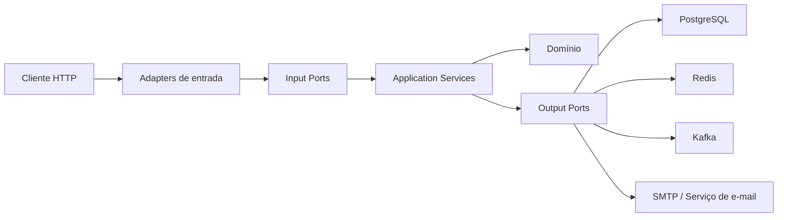
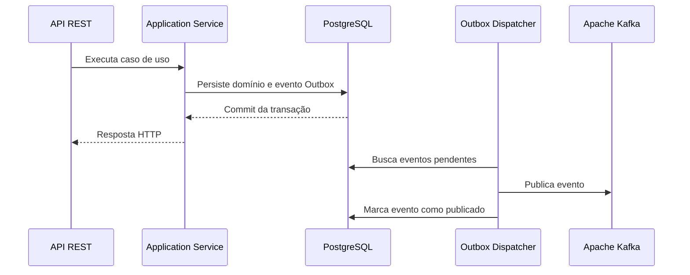
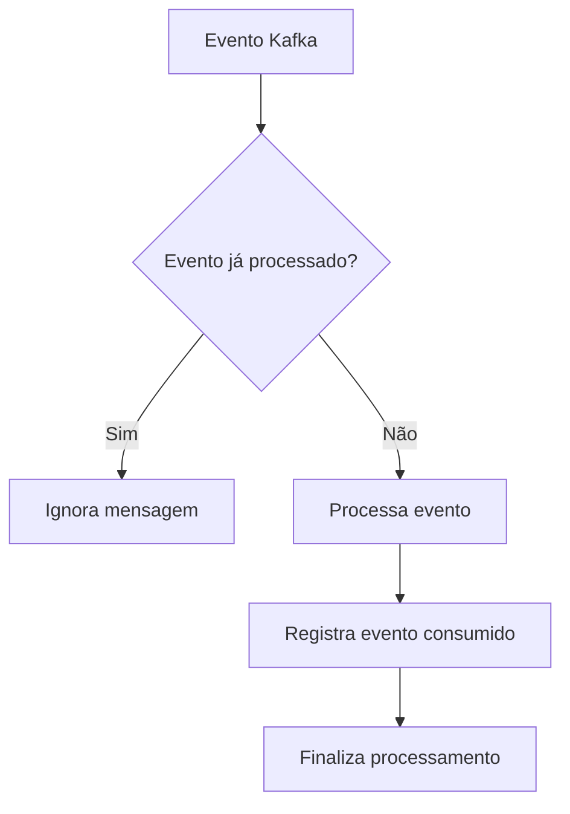

# 🛡️ ShopFlow Identity Service

Microsserviço responsável pelo ciclo de vida de usuários, endereços, autenticação, autorização e segurança do ecossistema ShopFlow.

O serviço utiliza **Domain-Driven Design (DDD)** e **Arquitetura Hexagonal**, mantendo o domínio independente de Spring, JPA, bancos de dados e sistemas de mensageria.

## 📋 Sumário

- [🛡️ ShopFlow Identity Service](#️-shopflow-identity-service)
  - [📋 Sumário](#-sumário)
  - [🏛️ Arquitetura](#️-arquitetura)
    - [Princípios](#princípios)
  - [🔄 Fluxos distribuídos](#-fluxos-distribuídos)
    - [Transactional Outbox](#transactional-outbox)
    - [Consumo idempotente](#consumo-idempotente)
  - [🔒 Segurança](#-segurança)
    - [Senhas](#senhas)
    - [Access tokens](#access-tokens)
    - [Refresh tokens](#refresh-tokens)
    - [Proteções adicionais](#proteções-adicionais)
  - [📦 Estrutura de pacotes](#-estrutura-de-pacotes)
  - [🗄️ Banco de dados](#️-banco-de-dados)
  - [🧪 Testes](#-testes)
  - [🚀 Execução local](#-execução-local)
    - [Pré-requisitos](#pré-requisitos)
    - [Iniciar a infraestrutura](#iniciar-a-infraestrutura)
    - [Iniciar a aplicação](#iniciar-a-aplicação)
  - [⚙️ Variáveis de ambiente](#️-variáveis-de-ambiente)
  - [✅ Checklist de produção](#-checklist-de-produção)

---

## 🏛️ Arquitetura

A aplicação é organizada em camadas, seguindo o padrão Ports and Adapters:



### Princípios

- **Domínio independente:** não utiliza anotações Spring ou JPA.
- **Casos de uso explícitos:** a camada de aplicação coordena as operações.
- **Ports and Adapters:** integrações externas dependem de interfaces.
- **Mapeamento explícito:** DTOs, entidades JPA e objetos de domínio são convertidos por mappers.
- **Limites transacionais:** cada caso de uso respeita a fronteira do aggregate correspondente.

---

## 🔄 Fluxos distribuídos

### Transactional Outbox

Os eventos são persistidos na mesma transação que altera os dados de domínio. Um dispatcher publica posteriormente esses eventos no Kafka.



Esse padrão evita o problema de **dual-write**, no qual a alteração no banco e a publicação da mensagem poderiam apresentar resultados inconsistentes.

### Consumo idempotente

Eventos consumidos são registrados para impedir processamento duplicado.



A limpeza de eventos antigos é realizada pelo `ConsumedEventsCleanupScheduler`.

---

## 🔒 Segurança

### Senhas

As senhas devem ser armazenadas utilizando **Argon2id**, por meio do adaptador de segurança da aplicação.

Configuração recomendada:

- Salt: 16 bytes
- Hash: 32 bytes
- Paralelismo: 1
- Memória: 64 MiB
- Iterações: 3

A configuração efetiva deve ser validada na implementação de `Argon2PasswordSecurityAdapter`.

### Access tokens

- Assinatura HMAC com **HS256**.
- Validade curta, por padrão, de 15 minutos.
- Validação estrita do algoritmo informado no token.
- Tokens devem ser mantidos apenas em memória no cliente.
- Não armazenar access tokens em `localStorage` ou `sessionStorage`.

### Refresh tokens

- Expostos exclusivamente por cookie HTTP.
- Devem utilizar `HttpOnly`.
- `Secure` deve ser habilitado em produção.
- `SameSite` deve ser configurado de acordo com o cenário de integração.
- Apenas o hash do token deve ser armazenado no banco de dados.

### Proteções adicionais

- Rate limiting distribuído com Redis.
- Blacklist de tokens por `jti` ou usuário.
- Normalização centralizada de entradas.
- Queries parametrizadas via Spring Data.
- Validação de ownership para evitar IDOR.
- Tratamento global de exceções sem exposição de stack traces.

> Cookies de autenticação devem ser acompanhados de uma estratégia adequada contra CSRF quando aplicável.

---

## 📦 Estrutura de pacotes

```text
com.matheuscrz.identity
├── domain
│   ├── model
│   ├── event
│   └── exception
├── application
│   ├── port
│   │   ├── in
│   │   └── out
│   └── service
├── adapter
│   ├── in
│   │   ├── web
│   │   └── messaging
│   └── out
│       ├── persistence
│       ├── redis
│       ├── security
│       ├── messaging
│       └── mail
└── config
```

| Pacote | Responsabilidade |
|---|---|
| `domain.model` | Aggregates, entidades e value objects |
| `domain.event` | Eventos de domínio |
| `domain.exception` | Exceções de negócio |
| `application.port.in` | Casos de uso de entrada |
| `application.port.out` | Contratos para integrações externas |
| `application.service` | Orquestração dos casos de uso |
| `adapter.in.web` | Controllers, DTOs e filtros HTTP |
| `adapter.in.messaging` | Consumidores Kafka |
| `adapter.out.persistence` | JPA, repositories e mappers |
| `adapter.out.redis` | Rate limiting, blacklist e recuperação |
| `adapter.out.security` | JWT e hashing de senhas |
| `adapter.out.messaging` | Outbox e publicação Kafka |
| `config` | Configurações do Spring Boot |

---

## 🗄️ Banco de dados

As migrações são gerenciadas pelo Flyway em:

```text
src/main/resources/db/migration
```

Migrações principais:

1. `V1__create_identity_tables.sql`
   - `users`
   - `user_addresses`
   - `refresh_tokens`

2. `V2__create_outbox_table.sql`
   - Tabela de eventos do Transactional Outbox.

3. `V3__harden_outbox.sql`
   - Índices e restrições para leitura concorrente.

4. `V4__create_consumed_events_table.sql`
   - Rastreamento de eventos consumidos.

---

## 🧪 Testes

A estratégia de testes inclui:

- **Testes unitários:** domínio, value objects e serviços de aplicação.
- **Testes de arquitetura:** validação das dependências entre camadas com ArchUnit.
- **Testes de integração:** PostgreSQL, Redis e Flyway utilizando Testcontainers.
- **Testes de segurança:** tokens inválidos, expiração, blacklist e rate limiting.

Executar a suíte completa:

```bash
./gradlew test
```

---

## 🚀 Execução local

### Pré-requisitos

- Java 21 ou superior
- Docker
- Docker Compose
- Gradle Wrapper

### Iniciar a infraestrutura

A partir do diretório de infraestrutura:

```bash
cd ../infra
docker compose up -d postgres redis kafka
```

### Iniciar a aplicação

A partir do diretório `identity`:

```bash
./gradlew bootRun
```

---

## ⚙️ Variáveis de ambiente

| Variável | Descrição | Padrão local |
|---|---|---|
| `SPRING_DATASOURCE_URL` | URL do PostgreSQL | `jdbc:postgresql://localhost:5432/shopflow_identity` |
| `SPRING_DATASOURCE_USERNAME` | Usuário do banco | `postgres` |
| `SPRING_DATASOURCE_PASSWORD` | Senha do banco | `postgres` |
| `SPRING_DATA_REDIS_HOST` | Host do Redis | `localhost` |
| `SPRING_DATA_REDIS_PORT` | Porta do Redis | `6379` |
| `SPRING_KAFKA_BOOTSTRAP_SERVERS` | Servidores Kafka | `localhost:9092` |
| `APP_JWT_SECRET` | Segredo HMAC de, no mínimo, 256 bits | Obrigatória |
| `APP_JWT_ACCESS_TOKEN_TTL_MS` | Validade do access token | `900000` |
| `APP_JWT_COOKIE_SECURE` | Habilita `Secure` no cookie | `false` local / `true` produção |

> Segredos reais não devem ser versionados. Utilize variáveis de ambiente ou um gerenciador de segredos.

---

## ✅ Checklist de produção

- [ ] Configurar `APP_JWT_SECRET` com alta entropia.
- [ ] Habilitar HTTPS.
- [ ] Habilitar `APP_JWT_COOKIE_SECURE`.
- [ ] Configurar CORS explicitamente.
- [ ] Validar política de CSRF.
- [ ] Monitorar falhas do Outbox Dispatcher.
- [ ] Configurar retenção da tabela de eventos consumidos.
- [ ] Não expor stack traces nas respostas HTTP.
- [ ] Não registrar tokens ou senhas nos logs.