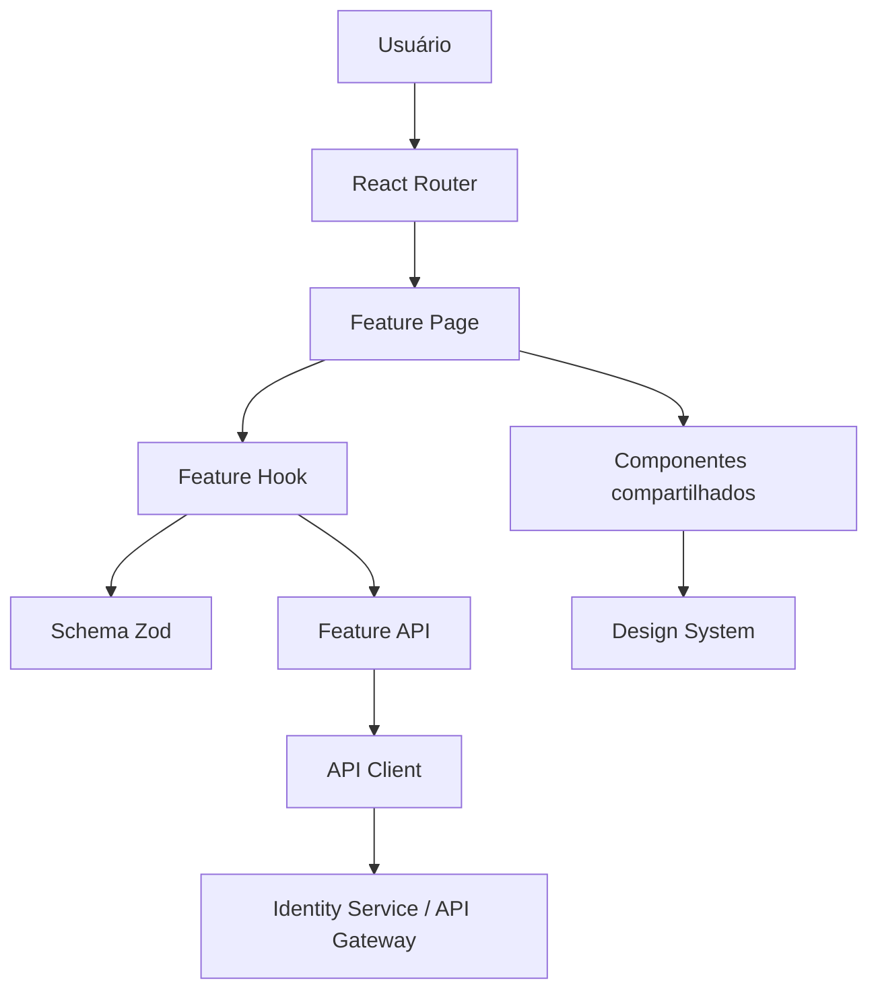
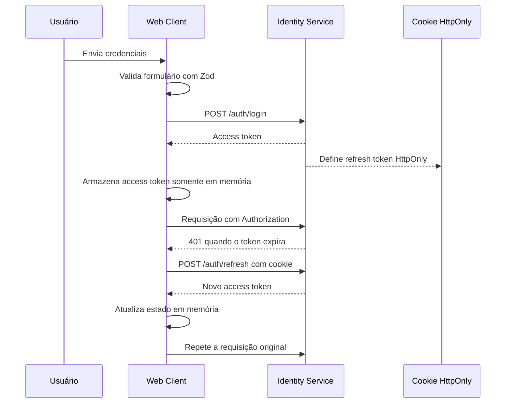

# 🌐 ShopFlow Web

Aplicação web do ecossistema ShopFlow, desenvolvida como uma **SPA (Single Page Application)** com React, TypeScript, Vite e TailwindCSS.

A aplicação utiliza **Feature-Driven Architecture**, mantendo cada módulo de negócio isolado e responsável por suas páginas, contratos, validações e integrações com a API.

## 📋 Sumário

- [Arquitetura](#-arquitetura)
- [Estrutura de diretórios](#-estrutura-de-diretórios)
- [Segurança](#-segurança)
- [Autenticação e renovação de sessão](#-autenticação-e-renovação-de-sessão)
- [Rotas](#-rotas)
- [Principais módulos](#-principais-módulos)
- [Configuração](#-configuração)
- [Execução local](#-execução-local)
- [Boas práticas](#-boas-práticas)

---

## 🏛️ Arquitetura

O frontend é organizado verticalmente por funcionalidade, evitando a concentração de regras de negócio em diretórios técnicos globais.



### Princípios

- **Feature-Driven Architecture:** funcionalidades agrupam código relacionado ao mesmo domínio.
- **Colocation:** páginas, hooks, schemas, tipos e chamadas de API ficam próximos.
- **Componentes reutilizáveis:** elementos visuais compartilhados ficam em `components/ui`.
- **Contratos tipados:** requisições e respostas possuem tipos TypeScript explícitos.
- **Validação no cliente:** formulários são validados com Zod antes do envio.
- **Estado mínimo:** somente dados realmente globais devem ser mantidos em stores.
- **Zero Trust:** dados recebidos da API ou inseridos pelo usuário são considerados não confiáveis.

---

## 📁 Estrutura de diretórios

```text
src/
├── assets/                  # Imagens, SVGs, fontes e outros recursos estáticos
├── components/
│   ├── layout/              # Shell, header, sidebar e wrappers de página
│   └── ui/                  # Componentes reutilizáveis do design system
├── config/
│   └── env.ts               # Leitura e validação das variáveis de ambiente
├── features/
│   ├── auth/
│   │   ├── api/             # Integrações HTTP de autenticação
│   │   ├── hooks/           # Hooks de autenticação
│   │   ├── pages/           # Login, cadastro e recuperação de acesso
│   │   ├── schemas/         # Schemas Zod
│   │   └── types/           # Tipos e contratos do módulo
│   └── profile/
│       ├── api/             # Perfil e endereços
│       ├── hooks/           # Hooks do módulo de perfil
│       ├── pages/           # Dashboard, perfil e endereços
│       ├── schemas/         # Schemas de perfil e endereço
│       └── types/           # Tipos do módulo
├── lib/
│   ├── api-client.ts        # Cliente HTTP e interceptors
│   ├── jwt.ts               # Leitura não confiável de claims do JWT
│   └── sanitize.ts          # Sanitização de conteúdo dinâmico
├── routes/
│   └── AppRoutes.tsx        # Rotas públicas, de convidado e protegidas
└── stores/
    ├── auth-store.ts        # Estado efêmero da sessão
    └── theme-store.ts       # Preferência de tema
```

---

## 🔒 Segurança

A segurança do cliente complementa, mas não substitui, a validação realizada pelo backend.

### Princípios adotados

- Não armazenar access tokens em `localStorage`, `sessionStorage` ou `IndexedDB`.
- Manter o access token somente em memória.
- Utilizar refresh token em cookie `HttpOnly`, quando suportado pelo backend.
- Habilitar `Secure` em produção.
- Configurar `SameSite` conforme o cenário de implantação.
- Utilizar HTTPS em ambientes não locais.
- Não registrar tokens, senhas ou dados sensíveis nos logs.
- Validar autorização sempre no backend.
- Não confiar em roles ou claims lidas exclusivamente no cliente.
- Sanitizar conteúdo antes de renderizá-lo em contextos HTML.
- Evitar o uso de `dangerouslySetInnerHTML`.

> Um token mantido em memória não fica acessível por APIs de armazenamento do navegador, mas um ataque XSS ainda pode executar ações no contexto da aplicação. A prevenção de XSS continua sendo obrigatória.

### CSRF

Quando cookies são utilizados para autenticação, o backend deve definir uma estratégia contra CSRF, como:

- cookies `SameSite` adequados;
- token CSRF;
- validação de origem;
- políticas CORS restritivas.

O cliente deve enviar credenciais somente para origens confiáveis.

---

## 🔐 Autenticação e renovação de sessão

Fluxo esperado de autenticação:



### Access token

- Deve possuir validade curta.
- É enviado no cabeçalho:

```text
Authorization: Bearer <access-token>
```

- Deve ser removido do estado quando ocorrer logout ou falha definitiva de renovação.
- O cliente pode ler claims para fins de interface, mas não deve utilizá-las como mecanismo de autorização.

### Refresh token

- Deve ser emitido pelo backend em cookie `HttpOnly`.
- Seu valor não deve ser acessível por JavaScript.
- Deve ser rotacionado e invalidado pelo backend conforme a política de segurança.
- O cliente deve utilizar `withCredentials: true` quando a API exigir cookies.

### Interceptors HTTP

O `api-client.ts` deve:

- anexar o access token disponível em memória;
- evitar múltiplas renovações simultâneas;
- repetir uma requisição apenas uma vez após renovação;
- impedir loops de renovação para o endpoint de refresh;
- tratar respostas `401` e `429`;
- respeitar `Retry-After` sem realizar retries agressivos;
- limpar a sessão quando a renovação falhar.

---

## 🧭 Rotas

As rotas são divididas em três categorias:

### Rotas públicas

Acessíveis sem autenticação:

- `/login`
- `/register`
- `/forgot-password`
- `/reset-password`

### Rotas de convidado

Destinadas a usuários não autenticados. Caso exista uma sessão válida, o usuário é redirecionado para `/dashboard`.

### Rotas protegidas

Exigem uma sessão válida ou passível de renovação:

- `/dashboard`
- `/profile`

Quando o usuário não está autenticado, a aplicação deve redirecioná-lo para o login e preservar a rota de destino.

---

## 📦 Principais módulos

| Diretório               | Responsabilidade                                |
| ----------------------- | ----------------------------------------------- |
| `src/config`            | Configuração tipada da aplicação                |
| `src/components/layout` | Estrutura visual compartilhada                  |
| `src/components/ui`     | Componentes reutilizáveis e acessíveis          |
| `src/features/auth`     | Login, cadastro, logout e recuperação de acesso |
| `src/features/profile`  | Perfil, dados cadastrais e endereços            |
| `src/lib/api-client.ts` | Cliente HTTP, credenciais e interceptors        |
| `src/lib/jwt.ts`        | Leitura de claims sem validar autoridade        |
| `src/lib/sanitize.ts`   | Sanitização de conteúdo dinâmico                |
| `src/routes`            | Definição e proteção de rotas                   |
| `src/stores`            | Estado global essencial e efêmero               |

---

## ⚙️ Configuração

Crie um arquivo `.env` na raiz de `web/`:

```env
VITE_API_BASE_URL=http://localhost:8080/api
```

As variáveis expostas pelo Vite possuem o prefixo `VITE_` e são incorporadas ao bundle do navegador. Portanto:

- não armazene segredos nesses arquivos;
- não inclua chaves privadas;
- não inclua credenciais administrativas;
- valide a URL antes de iniciar a aplicação.

A configuração deve ser centralizada em:

```text
src/config/env.ts
```

---

## 🚀 Execução local

### Pré-requisitos

- Node.js 20 ou superior;
- npm, pnpm ou Yarn;
- Identity Service ou API Gateway disponível.

### Instalar dependências

```bash
npm install
```

### Iniciar o ambiente de desenvolvimento

```bash
npm run dev
```

### Gerar build de produção

```bash
npm run build
```

### Pré-visualizar o build

```bash
npm run preview
```

---

## ✅ Boas práticas

- Manter regras de negócio dentro da feature correspondente.
- Evitar chamadas HTTP diretamente nos componentes de apresentação.
- Preferir hooks para orquestrar estado e efeitos colaterais.
- Reutilizar componentes de `components/ui`.
- Manter schemas Zod próximos aos formulários.
- Tratar estados de carregamento, erro e vazio.
- Garantir acessibilidade em formulários e navegação.
- Não expor informações sensíveis em mensagens de erro.
- Escrever testes para fluxos críticos de autenticação.
- Executar `build` antes de abrir um pull request.

## 🧪 Verificação antes do commit

```bash
npm run build
```
